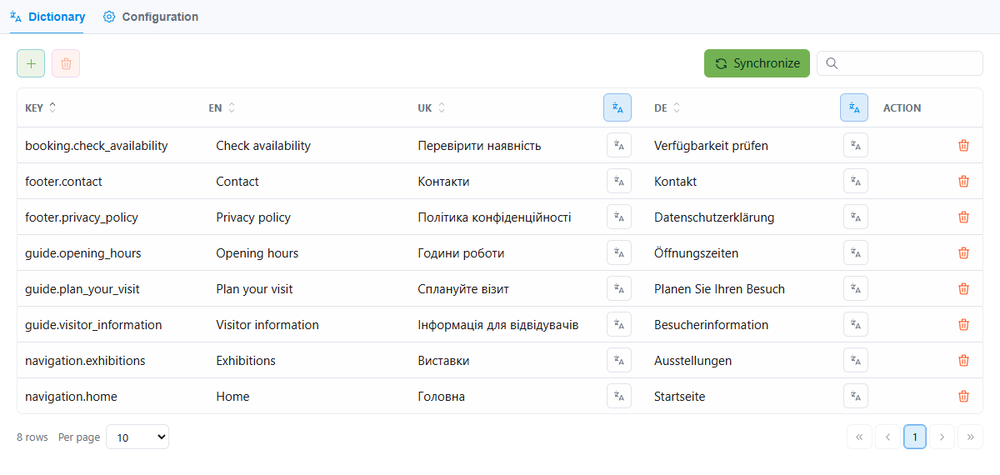

# sLang Dokumentation

**sLang** ist ein Modul zur Verwaltung mehrsprachiger Inhalte in Evolution CMS. Es unterstützt Übersetzungsphrasen, Frontend-Sprachen, mehrsprachige Ressource-Tabs, URL-Sprachsegmente, automatische Übersetzung und locale-aware Content-APIs.

## Screenshots

## Seiten

- [Erste Schritte](getting-started.md)
- [Benutzerhandbuch](user-guide.md)
- [Verwaltungs-Tabs](management-tabs.md)
- [Konfiguration](configuration.md)
- [Verwendung in Blade](use-in-blade.md)
- [Entwicklerhandbuch](developer-guide.md)
- [Referenz](reference.md)
- [Frontend-Leitfaden](frontend-guide.md)
- [Resource Bridge](resource-bridge.md)
- [Fehlerbehebung](troubleshooting.md)
- [Release Checklist](release-checklist.md)

## Funktionen

- Automatische Übersetzung von Phrasen über Google oder eigene Provider.
- Automatische Suche nach Übersetzungen in Templates.
- Mehrsprachige Tabs in Ressourcen.
- Unterstützung für unbegrenzt viele Übersetzungssprachen.
- Unterstützung für mehrsprachiges SEO.

## Locale-aware Content-Modell

- `Seiger\sLang\Models\sLangContent` verwendet standardmäßig die aktuelle Sprache über `evo()->getLocale()`.
- Eine Sprache kann explizit über den Scope `lang()` gewählt werden.
- Template Variables können mit `withTVs()` geladen werden.
- `langAndTvs()` bleibt für bestehenden Code verfügbar. Verwenden Sie für neue Abfragen `lang()` und `withTVs()`.
