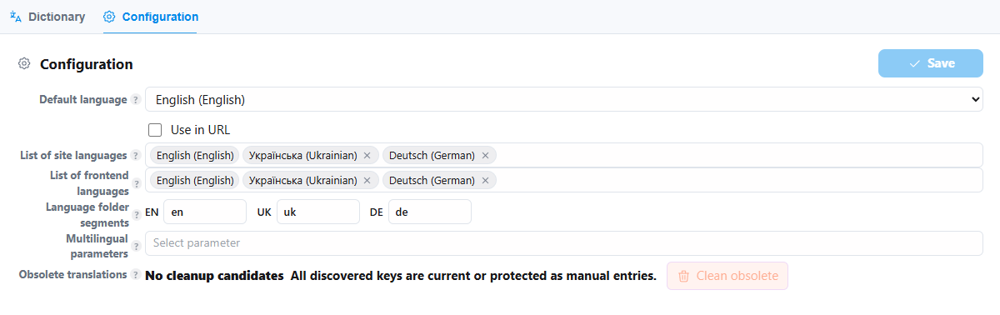

# sLang Documentation

[★ Star on GitHub](https://github.com/Seiger/sLang)

**sLang** is a multilingual management module for Evolution CMS. It helps manage translation phrases, frontend languages, multilingual resource tabs, URL language segments, automatic translation helpers, and locale-aware content APIs.

## Screenshots

## Pages

- [Getting Started](getting-started.md)
- [User Guide](user-guide.md)
- [Management tabs](management-tabs.md)
- [Configuration](configuration.md)
- [Use in Blade](use-in-blade.md)
- [Developer Guide](developer-guide.md)
- [Reference](reference.md)
- [Frontend Guide](frontend-guide.md)
- [Resource Bridge](resource-bridge.md)
- [Troubleshooting](troubleshooting.md)
- [Release Checklist](release-checklist.md)

## Features

- Automatic phrase translation through Google or custom translation providers.
- Automatic translation lookup in templates.
- Multilingual resource tabs.
- Unlimited translation language support.
- Multilingual SEO support.

## Locale-aware content model

- `Seiger\sLang\Models\sLangContent` respects the current locale by default through `evo()->getLocale()`.
- Explicit locale selection is available through the `lang()` scope.
- Template variables can be appended with `withTVs()`.
- `langAndTvs()` still works for existing code. Use `lang()` and `withTVs()` for new queries.
