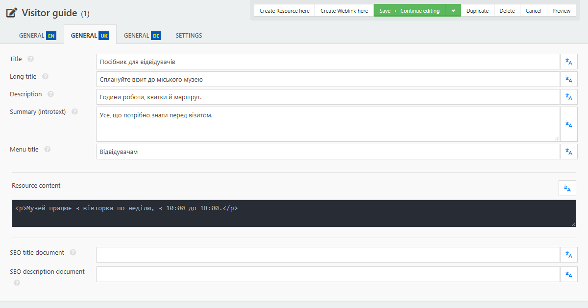

# Dokumentacja sLang

**sLang** to moduł zarządzania wielojęzycznością dla Evolution CMS. Pomaga obsługiwać słownik tłumaczeń, języki frontendu, wielojęzyczne zakładki zasobów, segmenty językowe URL, automatyczne tłumaczenia i API treści zależne od locale.

## Zrzuty ekranu

## Strony

- [Pierwsze kroki](getting-started.md)
- [Przewodnik użytkownika](user-guide.md)
- [Zakładki zarządzania](management-tabs.md)
- [Konfiguracja](configuration.md)
- [Użycie w Blade](use-in-blade.md)
- [Przewodnik dewelopera](developer-guide.md)
- [Referencja](reference.md)
- [Przewodnik frontend](frontend-guide.md)
- [Most zasobu](resource-bridge.md)
- [Rozwiązywanie problemów](troubleshooting.md)
- [Release checklist](release-checklist.md)

## Funkcje

- Automatyczne tłumaczenie fraz przez Google albo własnego providera.
- Automatyczne wyszukiwanie tłumaczeń w szablonach.
- Wielojęzyczne zakładki w zasobach.
- Obsługa nieograniczonej liczby języków.
- Obsługa wielojęzycznego SEO.

## Model treści zależny od locale

- `Seiger\sLang\Models\sLangContent` domyślnie używa aktualnej locale przez `evo()->getLocale()`.
- Jawny wybór języka jest dostępny przez scope `lang()`.
- Template Variables można dołączyć przez `withTVs()`.
- `langAndTvs()` działa w istniejącym kodzie. W nowych zapytaniach używaj `lang()` i `withTVs()`.
